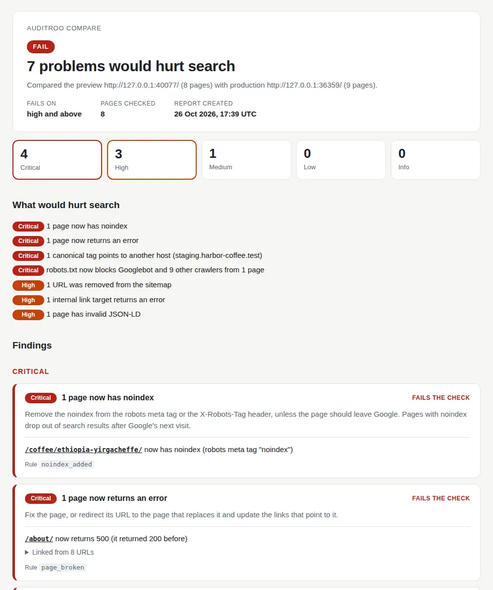

# auditroo

auditroo checks your website for SEO mistakes before a change goes live.
You run it on a preview deployment, and it compares the preview with your
live site. When a change would cost you search traffic, the build fails and
the log says which URL changed and how.

Some of the mistakes it finds:

- A page now has `noindex`. This tag tells Google to remove the page from
  its search results.
- A canonical tag points to your staging host. The canonical tag tells
  Google which URL to show for a page, so Google may show the staging host
  or drop the page.
- A new rule in robots.txt blocks Googlebot. robots.txt is the file that
  tells crawlers which pages they may fetch.
- Pages drop out of the sitemap, the XML file that lists your pages for
  search engines.
- Pages start to return errors, or links point to pages that no longer
  exist.
- A JSON-LD block is no longer valid. JSON-LD is the structured data that
  Google reads for rich results, such as product prices.

auditroo is one binary file with nothing else to install. It is open source
under the MIT license.

[Quickstart](docs/quickstart.md) · [CI recipes](docs/ci.md) · [Findings](docs/findings.md) · [JSON report](docs/json.md) · [Commands](docs/commands.md) · [AGENTS.md](AGENTS.md)

## Set it up with your coding agent

Paste this into your coding agent, inside the repository of your site:

```text
Add auditroo SEO checks to this project.
Use https://github.com/vincentsch/auditroo: read its AGENTS.md and follow
the steps. Run a first check on our production site and show me what it
finds. Then add the pull request check to our CI.
```

The agent looks up your production URL and how your previews are deployed.
It installs auditroo and tells you what a first check of production found.
Then it adds a CI job that compares each preview with production. It asks
you before it adds a secret or changes a deploy setting.

## Try it

```sh
curl -fsSL https://raw.githubusercontent.com/vincentsch/auditroo/main/install.sh | sh
auditroo demo
```

If the installer prints a PATH command, run that first. The demo starts a
small coffee shop site on your computer, together with a preview that has
typical deploy mistakes. Then it compares the two. It needs no internet
connection and takes about a second. This is what it prints:

```text
FAIL  7 problems would hurt search (fails on high and above)
  - 1 page now has noindex
  - 1 page now returns an error
  - 1 canonical tag points to another host (staging.harbor-coffee.test)
  - robots.txt now blocks Googlebot and 9 other crawlers from 1 page
  - 1 URL was removed from the sitemap
  - 1 linked URL is broken
  - 1 page has invalid JSON-LD

Critical
  /coffee/ethiopia-yirgacheffe/ now has noindex (robots meta tag "noindex")
      what to do: Remove the noindex from the robots meta tag or the X-Robots-Tag header, unless you want the page out of Google.
      rule: noindex_added
  /about/ now returns 500 (it returned 200 before)
      linked from: /, /brewing-guide/, /coffee/, /coffee/colombia-huila/, /coffee/ethiopia-yirgacheffe/ and 3 more
      what to do: Fix the page, or redirect its URL to the page that replaces it and update the links that point to it.
      rule: page_broken
  /coffee/colombia-huila/ canonical tag now points to another host (staging.harbor-coffee.test)
      before: /coffee/colombia-huila/
      after:  https://staging.harbor-coffee.test/coffee/colombia-huila/
      what to do: Point the canonical tag at the page's own URL.
      rule: canonical_external
  /robots.txt now blocks Googlebot and 9 other crawlers from 1 page that they could crawl before
      crawlers: Googlebot, Bingbot, OAI-SearchBot (ChatGPT search), ChatGPT-User, PerplexityBot, Claude-SearchBot, GPTBot (OpenAI training), ClaudeBot (Anthropic training), Google-Extended (Gemini training), CCBot (Common Crawl)
      blocked: /brewing-guide/
      what to do: Remove or narrow the Disallow rule in robots.txt.
      rule: robots_blocked

High
  1 URL that the sitemap listed before is no longer in it, although the page still works
      removed: /contact/
      what to do: Add the pages back to the sitemap, or check why the sitemap generator no longer sees them.
      rule: sitemap_urls_removed
  /shipping/ returns 404
      linked from: /, /brewing-guide/, /coffee/, /coffee/colombia-huila/, /coffee/ethiopia-yirgacheffe/ and 3 more
      what to do: Fix the linked page, or change the links to point to a page that works.
      rule: broken_link
  /coffee/house-blend/ has a JSON-LD block that is not valid JSON (trailing comma at line 1 column 137)
      what to do: Fix the JSON syntax.
      rule: structured_data_invalid

Below the fail-on level (high)
  medium  /contact/ has a new title
          before: "Contact | Harbor Coffee Roasters"
          after:  "Contact us | Harbor Coffee Roasters"
          rule: title_changed

Compared the preview http://127.0.0.1:36359/ (8 pages) with production http://127.0.0.1:37243/ (9 pages). Took 0.2 s.
```

Run `auditroo demo --html report.html` to get the same result as a page
that you can open in a browser or attach to a CI run.

<details>
<summary>See the HTML report</summary>



</details>

## Check your own site

```sh
auditroo check https://www.example.com
```

`check` crawls the site from the start page. It reads robots.txt and the
sitemaps and follows internal links. Then it reports the problems that one
crawl can show, for example broken links or a noindex page in the sitemap.

auditroo treats the URL you give it as your live site. If you check a local
build and its canonical tags still use your live domain, add
`--production-url https://www.example.com`. Otherwise auditroo reports them
as canonical tags on another host.

By default auditroo fetches about 10 pages a second. On a preview or a local
build you can turn the wait off with `--rate-limit-ms 0`.

To compare a preview or staging deployment with production:

```sh
auditroo compare https://www.example.com https://my-branch.example.vercel.app
```

`compare` crawls both sites and matches pages by path, so `/pricing/` on
the preview is compared with `/pricing/` on production. It also fetches each
production page on the preview, so a deleted page shows up even when nothing
links to it anymore.

Previews often still use the production domain in canonical tags and in the
sitemap. auditroo then reads those URLs on the preview. A URL on any other
host, for example a staging server, is reported as a problem.

Vercel and Netlify add a noindex header to every preview. auditroo ignores
that header on their preview domains, but it still checks the robots meta
tag in your HTML.

When the preview's robots.txt blocks pages that production's robots.txt
allows, auditroo reports the new block. It still checks those pages on the
preview, so the block cannot hide other problems behind it.

A run never passes when auditroo could not see the site. If production
answers 403, the run stops with an error. If every page of the preview
redirects to a login page, that is a critical finding.

## Add it to pull requests

If you deploy previews on Vercel, this GitHub Actions workflow runs after
each preview deployment. It does not run for production deployments:

```yaml
# .github/workflows/seo.yml
name: SEO
on: deployment_status

permissions:
  contents: read

jobs:
  auditroo:
    if: >-
      github.event.deployment_status.state == 'success' &&
      !startsWith(github.event.deployment.environment, 'Production')
    runs-on: ubuntu-latest
    steps:
      - uses: vincentsch/auditroo@v0.1.0
        env:
          PREVIEW_URL: ${{ github.event.deployment_status.target_url }}
        with:
          args: compare https://www.example.com "$PREVIEW_URL"
```

The job fails when a finding is high or critical. The report goes to the job
summary, and the findings show up as annotations on the pull request.

Leave `--ignore-robots` out of CI. In `compare` it applies to production
too, so auditroo would also crawl the pages that your live robots.txt
blocks for it. Pages that only the preview's robots.txt blocks are checked
without the flag.

If you add an `auditroo.toml`, check it out from your main branch in the
workflow. Then a pull request cannot add ignore rules that hide its own
problems. [CI recipes](docs/ci.md) shows how, and has more setups, for
example for Cloudflare Pages or for a preview behind password protection.

## What the findings mean

Every finding has a severity. A run fails when a finding reaches `--fail-on`,
which is `high` unless you change it.

| Severity | Example |
| --- | --- |
| Critical | A page that Google could index now has noindex. |
| High | Pages were removed from the sitemap. |
| Medium | A page has a new title. |
| Low | A page has a new meta description. |
| Info | A new page was added. |

Every finding in the output names its rule, for example
`rule: title_changed`. Findings that fail the run also say what to do.
[Findings](docs/findings.md) explains each rule in more detail, and
`auditroo explain title_changed` prints that text in the terminal. When a
finding is expected, for example because you changed a title on purpose,
add an ignore rule with that name to `auditroo.toml`, or pass
`--ignore '{ rule = "title_changed" }'`. [Configuration](docs/configuration.md)
has the details.

## Exit codes

| Code | Meaning |
| --- | --- |
| 0 | No finding at or above `--fail-on`. |
| 1 | At least one finding at or above `--fail-on`. The check failed. |
| 2 | Usage or configuration error. Fix the command or `auditroo.toml`. |
| 3 | Network or runtime error. A site could not be reached or crawled, or a file could not be written. |

## More

- [Quickstart](docs/quickstart.md): install and run your first check
- [CI recipes](docs/ci.md): pull request checks on GitHub and other CI systems
- [Crawling your own site](docs/own-site.md): firewalls and crawl speed
- [JavaScript sites](docs/javascript.md): rendering pages in headless Chrome
- [Configuration](docs/configuration.md): fail-on and ignore rules in `auditroo.toml`
- [JSON report](docs/json.md): the fields of `--json` and `--out`, for scripts and coding agents
- [Troubleshooting](docs/troubleshooting.md) and [FAQ](docs/faq.md)
- [Experimental features](docs/experimental.md): commands that may still change before 1.0

## Install options

Each release has binaries for the three desktop systems, on x86_64 and
arm64. The installer is a shell script for Linux and macOS, and for Git Bash
on Windows. Before it installs anything, it checks the download against the
SHA-256 checksum of the release. It puts the binary in `~/.local/bin`, or in
`INSTALL_DIR` when you set it. Set `AUDITROO_VERSION=v0.1.0` to pin a
version. You can also run auditroo in Docker or build it from source. The
[quickstart](docs/quickstart.md#install) has the commands.

[CONTRIBUTING.md](CONTRIBUTING.md) explains how to build and test auditroo.
[RELEASE.md](RELEASE.md) describes how releases are made. Report security
issues as described in [SECURITY.md](SECURITY.md).

## License

[MIT](LICENSE). Made by [Vincent Schmalbach](https://www.vincentschmalbach.com/).
